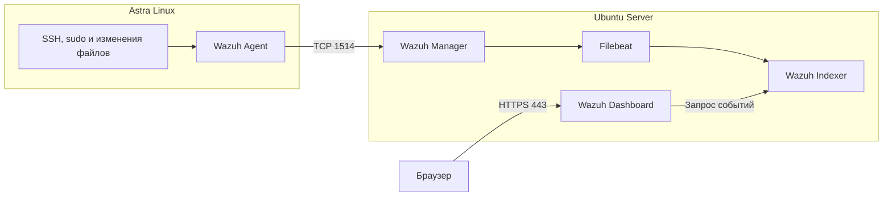

# Мой SIEM-стенд на Wazuh

В этом проекте я развернул Wazuh в VirtualBox и подключил к нему отдельную виртуальную машину с Astra Linux. Хотел разобраться, как SIEM собирает события с Linux и как искать их в интерфейсе.

## Что использовал

| Что | Для чего |
|---|---|
| Windows 10 и VirtualBox | Хост и запуск виртуальных машин |
| Ubuntu Server 24.04 LTS | Сервер Wazuh |
| Astra Linux Orel 2.12.46 | Машина с агентом |
| Wazuh 4.14.10 | Сбор и анализ событий |

## Как устроен стенд

На Ubuntu я установил Wazuh Manager, Indexer, Dashboard и Filebeat. На Astra Linux — Wazuh Agent. Для связи между виртуальными машинами выбрал сетевой мост.



## Что я сделал

- Подготовил две виртуальные машины и настроил связь между ними.
- Установил серверные компоненты Wazuh и открыл Dashboard.
- Установил агент на Astra Linux и зарегистрировал его на сервере.
- Проверил подключение Filebeat к Indexer.
- Нашёл события SSH в `/var/log/auth.log` и в Threat Hunting.
- Проверил регистрацию событий `sudo`.
- Настроил FIM для `/opt/siem-fim-test/` и проверял создание, изменение и удаление файла.

## Результат

У меня получился учебный стенд с одним Linux-агентом. Через Dashboard я могу смотреть события с Astra Linux и разбирать, что происходило на этой машине.

Скриншоты добавлю позже. Примеры XML в `configs/examples/` оставил для настройки похожего стенда; это не копии моего полного конфига.

## Что лежит в репозитории

- [Архитектура](docs/architecture.md) — виртуальные машины, ресурсы и порты.
- [Установка Wazuh](docs/deployment.md) и [подключение агента](docs/agent-setup.md).
- [Проверки SSH, sudo и FIM](docs/detection-tests.md).
- [Результаты](docs/results.md) и [проблемы при настройке](docs/troubleshooting.md).
- [Примеры конфигурации](configs/examples/README.md).
- [Скриншоты](screenshots/README.md).

Для быстрой проверки служб и версий есть [collect-health.sh](scripts/collect-health.sh):

```bash
bash scripts/collect-health.sh server
# На машине с агентом:
bash scripts/collect-health.sh agent
```

Скрипт только выводит информацию, настройки не меняет.
