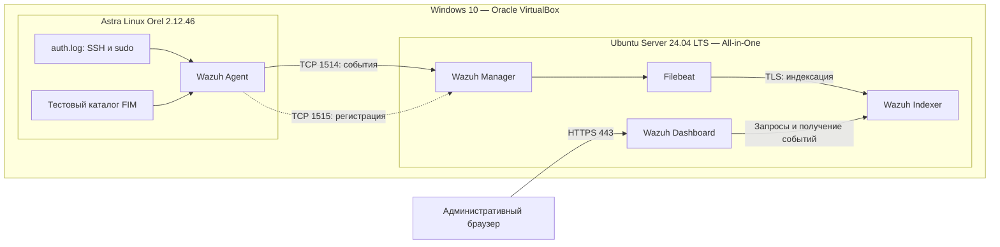

# Wazuh SIEM Lab — Ubuntu Server + Astra Linux

Учебный стенд для централизованного сбора и анализа событий безопасности Linux: Wazuh All-in-One на Ubuntu Server и отдельный агент на Astra Linux в Oracle VirtualBox.

**Стек:** Wazuh · Ubuntu Server · Astra Linux · VirtualBox · Linux logs · SSH · sudo · File Integrity Monitoring

> **Статус:** по описанию автора стенд развёрнут, агент подключён; выполнены проверки SSH, sudo и изменений файлов. Репозиторий оформлен по техническому описанию проекта. Исходные конфигурации, журнал установки и упомянутые 14 скриншотов пока не приложены. Примеры в `configs/examples/` восстановлены для документации и не являются экспортом работающего стенда. Стенд при подготовке репозитория повторно не запускался.

## Задача проекта

Создать локальный SIEM-стенд и пройти путь от установки серверных компонентов до получения событий с отдельного Linux-узла в Wazuh Dashboard. Проект ориентирован на практику начинающего SOC-аналитика: подключение источника, поиск событий, проверка контекста и диагностика доставки.

## Архитектура



ВМ связаны через **Bridged Adapter**. Реальные адреса не опубликованы. Версия Wazuh Server/Agent, указанная автором, — **4.14.10**; вывод установленной версии ещё не приложен. Filebeat используется в составе All-in-One, его точная версия отдельно не известна.

## Что сделано

- Подготовлена локальная виртуальная инфраструктура.
- Установлены Wazuh Manager, Indexer, Dashboard и Filebeat.
- Подключён и зарегистрирован Linux-агент на Astra Linux.
- Проверена доставка событий аутентификации SSH и использование sudo.
- Настроен контроль каталога `/opt/siem-fim-test/`; выполнялись создание, изменение и удаление файла.
- Проверено соединение Filebeat с Indexer; по описанию автора TLS handshake завершался успешно.
- Проведена диагностика проблем установки, запуска служб и сети.

Все пункты выше отражают предоставленное описание автора. Точные команды устранения ошибок, rule ID, уровни алертов и изображения нужны для независимой проверки. Сведения о фактическом состоянии собраны в [таблице результатов](docs/results.md).

## Как читать репозиторий

| Раздел | Содержание |
|---|---|
| [Архитектура](docs/architecture.md) | Узлы, ресурсы, порты и ограничения стенда |
| [Развёртывание](docs/deployment.md) | Восстановленный порядок и проверка компонентов |
| [Подключение агента](docs/agent-setup.md) | Astra Linux, регистрация и источники событий |
| [Сценарии обнаружения](docs/detection-tests.md) | SSH, sudo, FIM и фиксация результатов |
| [Результаты](docs/results.md) | Что сообщено автором и какие доказательства доступны |
| [Диагностика](docs/troubleshooting.md) | Известные проблемы и границы доступных сведений |
| [Примеры настроек](configs/examples/README.md) | XML-фрагменты с пояснениями по применению |
| [Снимки экрана](screenshots/README.md) | План размещения фактических скриншотов |
| [Публикация на GitHub](docs/github-publishing.md) | Загрузка, описание и закрепление проекта в профиле |
| [Текст для портфолио](docs/portfolio.md) | Описание проекта и пункты для резюме |

## Повторение стенда

1. Изучить [характеристики и ограничения](docs/architecture.md). Сообщённые значения RAM относятся к разным этапам и не являются готовой схемой одновременного запуска ВМ.
2. Подготовить ВМ и установить совместимые версии по [порядку развёртывания](docs/deployment.md). Автоматизированный установщик в репозитории отсутствует: исходная последовательность команд не предоставлена.
3. [Подключить Astra Linux](docs/agent-setup.md), сверив версии и сетевую доступность.
4. Выполнить [контрольные сценарии](docs/detection-tests.md), сохранив свои результаты.

Для локальной диагностики добавлен новый вспомогательный скрипт:

```bash
bash scripts/collect-health.sh server
# На ВМ Astra Linux:
bash scripts/collect-health.sh agent
```

Он выводит версии пакетов, состояние служб и ресурсы; не устанавливает ПО и не меняет конфигурацию. Это инструмент подготовки портфолио, а не скрипт, использовавшийся в исходном проекте. Вывод проверяйте перед публикацией; диагностические отчёты исключены через `.gitignore`.

## Границы проекта

- Один Linux-агент; Windows 10 служит хостом, агент на Windows не установлен.
- Нет подтверждения собственных правил/декодеров, отдельного завершённого SCA-сценария, Active Directory, уведомлений или Active Response.
- Отказоустойчивость, резервное копирование, производственная эксплуатация и длительное нагрузочное тестирование не заявлены.
- Незавершённый эксперимент с ИИ-агентом в Docker не входит в архитектуру SIEM.

## Источники и происхождение материалов

Основа репозитория — техническое описание, предоставленное автором проекта. Подробности: [источник и ограничения](docs/source-and-scope.md). Официальная документация Wazuh указана как справочный материал, а не доказательство фактических действий автора.

**English summary:** A local Wazuh SIEM lab with an Ubuntu Server all-in-one deployment and an Astra Linux agent in VirtualBox. The project documents Linux authentication monitoring and FIM checks reported by the author. Original screenshots and configuration exports are pending; supplied XML examples are reconstructed, not captured from the running lab.
